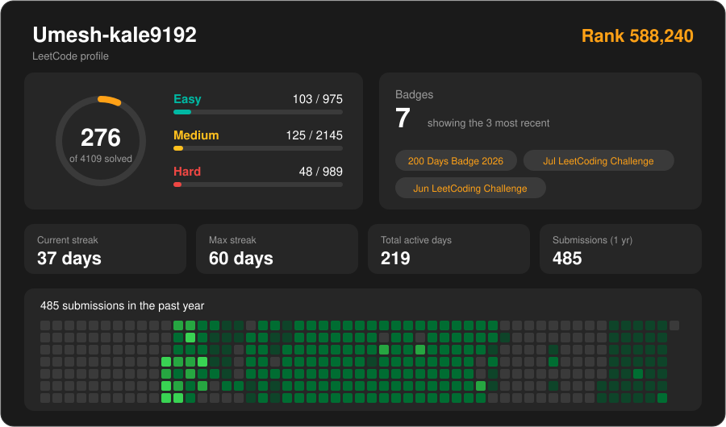
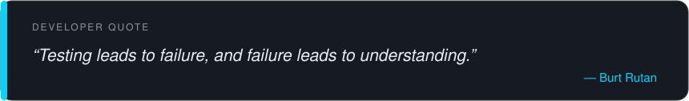

  

  

   

  
  
  
  

---

## 👨‍💻 About Me

I'm a final-year **Artificial Intelligence & Machine Learning engineering student** and a **Software Developer at Medini Technologies**.

I enjoy building intelligent applications that combine AI/ML capabilities with practical software engineering.

My work spans backend development, machine learning, computer vision and full-stack application development. I work with **Python, Node.js, Express.js, MongoDB, PostgreSQL and Redis**, and explore Generative AI by integrating LLM APIs such as OpenAI, Claude and Gemini into real-world applications.

Beyond development, I actively explore open-source projects, collaborate with developers and contribute to building a stronger AI/ML community as the **Vice President of AI-YuGa**.

- 🔭 Currently working on backend systems and AI-powered applications.
- 🤖 Exploring Generative AI, LLM integrations and intelligent automation.
- ⚙️ Interested in scalable backend architecture and production-ready applications.
- 🌱 Continuously improving my skills in AI engineering and full-stack development.
- 🤝 Interested in open-source contributions, collaborations and meaningful projects.

  

---

## 🛠️ Technology Stack

### 💻 Programming Languages

  
  

### 🎨 Frontend Development

  
  
  
  
  

### ⚙️ Backend Development

  
  
  
  
  

### 🤖 Artificial Intelligence & Machine Learning

  
  
  

### 🧠 Generative AI & LLM Engineering

  
  
  

### 👁️ Computer Vision

  
  

### 🗄️ Databases & Caching

  
  
  

### 🔧 Developer Tools & API Testing

  
  
  
  
  
  

---

## 🌱 Currently Exploring

- 🧩 **Generative AI:** Integrating OpenAI, Claude and Gemini APIs into Node.js and Python applications.
- 🧠 **Embeddings & Semantic Search:** Moving beyond traditional TF-IDF towards embedding-based retrieval.
- 🔍 **RAG Systems:** Exploring document retrieval, vector embeddings and context-aware AI applications.
- 🤖 **AI Agents:** Learning tool calling, agentic workflows and intelligent automation.
- ⚡ **Backend Engineering:** Going deeper into Redis, scalable APIs and backend architecture.
- 🚀 **Production AI:** Connecting machine learning models and LLMs with real-world software systems.

---

## 📈 GitHub Activity

  

---

## 🕹️ Pac-Man Eats My Contributions

  <picture>
    <source media="(prefers-color-scheme: dark)" srcset="https://raw.githubusercontent.com/UMESH-KALE0777/UMESH-KALE0777/main/assets/pacman-contribution-graph-dark.svg">
    <source media="(prefers-color-scheme: light)" srcset="https://raw.githubusercontent.com/UMESH-KALE0777/UMESH-KALE0777/main/assets/pacman-contribution-graph.svg">
    
  </picture>

---

## 🧩 LeetCode

  
   
  

---

## 🤝 Open Source Contributions

I enjoy contributing to open-source projects, improving existing implementations and collaborating with developers.

| Repository | Contribution |
|:---|:---|
| [llm-hallucination-checker-edge](https://github.com/CallmeKeefe/llm-hallucination-checker-edge) | [Pull Request #9](https://github.com/CallmeKeefe/llm-hallucination-checker-edge/pull/9) |
| [eliminate-cigarettes](https://github.com/Ahmet-Dedeler/eliminate-cigarettes) | [Pull Request #4](https://github.com/Ahmet-Dedeler/eliminate-cigarettes/pull/4), [Pull Request #6](https://github.com/Ahmet-Dedeler/eliminate-cigarettes/pull/6), [Issue #2](https://github.com/Ahmet-Dedeler/eliminate-cigarettes/issues/2) |

---

## 💬 Developer Quote

  

---

## 📬 Let's Connect

I'm always interested in connecting with developers, exploring new opportunities, contributing to open source and building meaningful technology.

  
    
  
    
  

